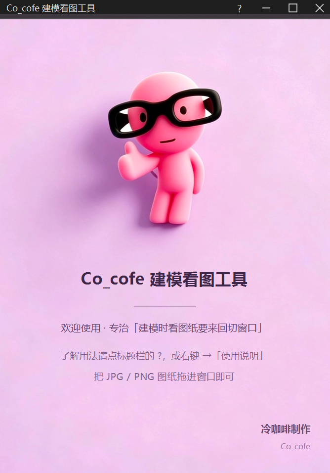

# Co_cofe 建模看图工具

> 把图纸钉在所有窗口最上层的小工具 —— **不挑软件**，SolidWorks / CATIA / UG(NX) / Creo / Inventor 都能用。
>
> A tiny always-on-top image viewer for CAD users. Works with **any** modeling software on Windows.



---

## 它解决什么问题

建模时想看一眼图纸，就得切窗口、缩放、再切回来。一上午切几百次，思路断得七零八落。

这个工具把图纸变成一个**永远浮在最上层**的小窗：可调大小、可调透明度、可滚轮缩放，而且**不抢焦点**——点它、拖它，SolidWorks 里正在跑的命令不会断，键盘输入也不会丢。

---

## 为什么它"不挑软件"

因为它**不是插件**。

它不调用任何 CAD 的接口，不往注册表里塞东西，也不改你的软件设置——它只是一个置顶的图片窗口，下面是谁都行。所以：

| 类别 | 举例 |
|---|---|
| 三维建模 | SolidWorks、CATIA、UG(NX)、Creo(Pro/E)、Inventor、Solid Edge、Fusion 360、Rhino、CAXA、中望3D |
| 编程加工 | Mastercam、PowerMill、Cimatron、Mastercam、CAXA制造工程师 |
| 其他 | PDF 阅读器、Excel 里的 BOM 表、网页上的标准件参数、WPS |

换公司、换软件、换版本，都不用重新学一遍。

---

## 特性

- **永远置顶** — `WS_EX_TOPMOST`，主窗口最大化也压不住
- **不抢焦点** — `WS_EX_NOACTIVATE`，点它拖它不断你正在做的操作
- **可调透明度** — `WS_EX_LAYERED`，图纸半透，底下模型直接看得见
- **点击穿透** — 一键变纯显示，鼠标直接点到底下的软件上
- **拖边改大小** — 图片跟着窗口自动缩放
- **滚轮缩放 / 双击复位 / Ctrl+拖动平移**
- **全局热键** — 隐藏、穿透都能一键切
- **记住状态** — 窗口位置、大小、透明度、上次打开的图
- **轻、干净** — 222 KB，免安装，不联网、不写注册表，删掉文件夹就卸载干净

---

## 快捷键

| 操作 | 说明 |
|---|---|
| 拖动画面 / 标题栏 | 移动窗口 |
| 拖四条边、四个角 | 改窗口大小（图纸自动跟着缩放） |
| `Ctrl` + 滚轮 | 调透明度（5% 一档） |
| 滚轮 | 放大缩小（1x = 适应窗口，最大 10x） |
| 双击画面 | 复位缩放 |
| `Ctrl` + 左键拖 | 放大后平移图纸 |
| `Shift` + 滚轮 | 切换多张图 |
| `Ctrl` + `Alt` + `O` | 显示 / 隐藏 |
| `Ctrl` + `Alt` + `P` | 点击穿透 |
| 右键 / 标题栏 `?` | 菜单 / 使用说明 |

---

## 下载与使用

### 方式一：直接下载（推荐）

到 [Releases](../../releases) 下载：

- `CoCofe-Viewer-v1.0.0-setup.exe` — 安装版，向导安装，可在「设置 → 应用」里卸载
- `CoCofe-Viewer-v1.0.0-portable.exe` — 绿色版，双击即用（欢迎页底图已内嵌，单文件也完整）

> 程序自身叫「Co_cofe建模看图工具」；Release 附件名用英文，是因为 GitHub 会把
> 非 ASCII 文件名替换掉（试过中文名，会被改成 `Co_cofe.exe` 这种）。

> 程序未做代码签名，首次运行时 Windows SmartScreen 可能提示"未知发布者"，
> 点「更多信息 → 仍要运行」即可。

### 方式二：自己编译

不需要 Visual Studio，用 Windows 自带的 .NET Framework 编译器即可：

```powershell
git clone https://github.com/x0717-zmy/co-cofe-viewer.git
cd co-cofe-viewer
powershell -ExecutionPolicy Bypass -File build\build.ps1
```

产物在 `dist\` 目录。

---

## 目录结构

```
src\        SwPin.cs（主程序全部源码）、AssemblyInfo.cs（版本信息）
installer\  Setup.cs（安装 + 卸载，一个文件两个入口）、app.manifest（UAC 清单）
assets\     welcome.jpg（欢迎页底图）、logo.png（图标源图）、app.ico
docs\       使用说明.txt、快速上手.txt
build\      build.ps1 一键构建脚本
```

---

## 实现要点

| 需求 | 做法 |
|---|---|
| 置顶 | `WS_EX_TOPMOST` |
| 半透明 | `WS_EX_LAYERED` + `SetLayeredWindowAttributes(LWA_ALPHA)` |
| 不抢焦点 | `WS_EX_NOACTIVATE` |
| 拖边改大小 | 处理 `WM_NCHITTEST` 返回 `HTLEFT/HTRIGHT/...`，交给系统处理 |
| 右键菜单 | **窗口内部自绘**。系统弹出菜单要求窗口先激活，实测会闪一下就消失，`SetForegroundWindow` + `AttachThreadInput` 也压不住 |
| 欢迎页 | GDI+ 把底图等比铺满（裁切偏上保证主体完整）再叠文字；底图编进 exe 作为兜底，外部同名文件优先 |
| 图标 | 多尺寸 `app.ico`，`csc /win32icon` 内嵌 |
| 单文件安装包 | 把主程序、素材、卸载程序作为资源塞进安装程序，运行时释放 |

依赖：Windows 10/11 + 系统自带 .NET Framework 4.x。无第三方库。

---

## 已知限制

- 只支持图片（png / jpg / jpeg / bmp / gif / tif / tiff），**不支持 PDF**；PDF 请先截图或导出成图片
- 透明度作用于整个窗口（含边框），不能只让图纸白底变透明
- 未做代码签名，首次运行有 SmartScreen 提示
- 全局热键 `Ctrl+Alt+O` / `Ctrl+Alt+P` 若与其他软件冲突，改 `src\SwPin.cs` 里的常量即可

---

## 常见问题

**杀毒软件报毒？** 程序没有联网行为、没有安装器外壳、不写注册表，只有置顶绘图和本地文件读写。可自行从源码编译验证。

**为什么右键菜单长得和系统菜单不一样？** 见上面实现要点——不抢焦点的窗口无法弹出系统菜单，只能自绘。

**数据存在哪？** `%APPDATA%\SwPin\state.txt`，只有窗口位置、大小、透明度、上次打开的图。删掉即恢复默认。

---

## 许可

[MIT](LICENSE) © 2026 冷咖啡制作
